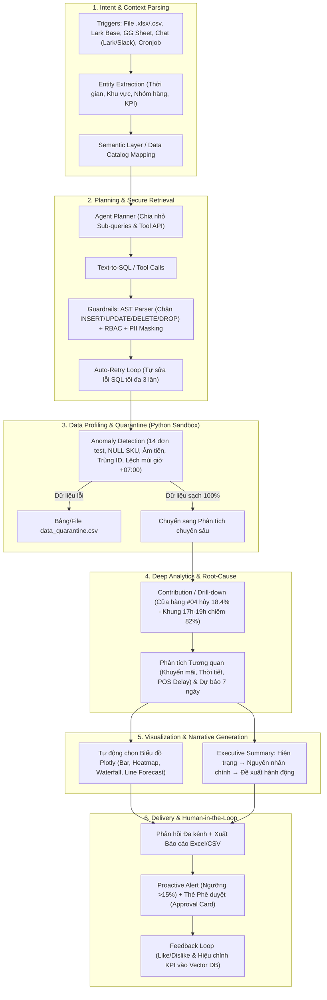

# 🤖 Enterprise Data Analytics AI Agent (6-Step Pipeline)

Hệ thống **AI Agent Phân tích Dữ liệu Doanh nghiệp** được thiết kế và hiện thực hóa đầy đủ theo kiến trúc 6 bước khép kín, từ tiếp nhận đa kênh, kiểm duyệt bảo mật AST/RBAC, làm sạch dữ liệu trong Sandbox đến phân tích nguyên nhân gốc rễ (Root-Cause), trực quan hóa Plotly và cảnh báo chủ động (Human-in-the-loop).

---

## 🏗️ Sơ đồ Kiến trúc 6 Bước



---

## 📂 Cấu trúc Thư mục Dự án

| File | Vai trò trong kiến trúc 6 bước |
| :--- | :--- |
| [`index.html`](file:///c:/Users/TGPM/Downloads/Đề%20GK/index.html) | **Giao diện Web App Tương tác (Chạy ngay trên trình duyệt không cần cài đặt)** — Tích hợp đầy đủ 6 bước, biểu đồ Plotly, Upload `.xlsx`/`.csv`, Test AST Guardrail, Approval Card & Vector DB. |
| [`app.py`](file:///c:/Users/TGPM/Downloads/Đề%20GK/app.py) | Giao diện **Streamlit Web App** dành cho môi trường Python. |
| [`agent_pipeline.py`](file:///c:/Users/TGPM/Downloads/Đề%20GK/agent_pipeline.py) | **Orchestrator** điều phối khép kín 6 bước của AI Agent và quản lý bộ nhớ dài hạn Vector DB. |
| [`semantic_catalog.py`](file:///c:/Users/TGPM/Downloads/Đề%20GK/semantic_catalog.py) | **Bước 1:** Từ điển dữ liệu doanh nghiệp (`DATA_CATALOG`), công thức chuẩn KPI, chính sách phân quyền RBAC và bộ bóc tách thực thể (`parse_intent_and_context`). |
| [`planner_guardrails.py`](file:///c:/Users/TGPM/Downloads/Đề%20GK/planner_guardrails.py) | **Bước 2:** Bộ lập kế hoạch (`build_execution_plan`), kiểm duyệt cây cú pháp SQL (`validate_sql_ast_and_rbac`), che giấu PII (`mask_pii_record`) và vòng lặp tự sửa lỗi 3 lần (`execute_secure_query_with_retry`). |
| [`data_profiler_quarantine.py`](file:///c:/Users/TGPM/Downloads/Đề%20GK/data_profiler_quarantine.py) | **Bước 3:** Môi trường kiểm định dữ liệu cô lập (`run_sandbox_profiling_and_quarantine`) — lọc 14 đơn test nội bộ, NULL SKU, doanh thu âm, trùng mã hóa đơn, lệch múi giờ `+07:00` và xuất file cách ly. |
| [`deep_analytics_engine.py`](file:///c:/Users/TGPM/Downloads/Đề%20GK/deep_analytics_engine.py) | **Bước 4, 5 & 6:** Phân tích đóng góp (Contribution Drill-down), ma trận Heatmap theo khung giờ, tương quan ngoại cảnh, dự báo 7 ngày, tổng hợp Executive Summary (chế độ Hybrid LLM) và phát cảnh báo chủ động. |
| [`data_generator.py`](file:///c:/Users/TGPM/Downloads/Đề%20GK/data_generator.py) | Khởi tạo **SQLite Data Warehouse** (`data/enterprise_dw.db`) và bộ dữ liệu mẫu khớp 100% kịch bản vận hành thực tế. |
| [`data/data_quarantine_export.csv`](file:///c:/Users/TGPM/Downloads/Đề%20GK/data/data_quarantine_export.csv) | Dữ liệu các bản ghi bị cách ly ở Bước 3 để Kỹ sư dữ liệu kiểm tra. |

---

## 🚀 Hướng dẫn Chạy Thử (2 Cách)

### Cách 1: Mở trực tiếp Web App (Không cần cài đặt Python)
1. Nhấp đúp chuột mở trực tiếp file [`index.html`](file:///c:/Users/TGPM/Downloads/Đề%20GK/index.html) bằng trình duyệt (Chrome / Edge).
2. Trên giao diện bạn có thể:
   - Nhập câu hỏi vào khung Chat hoặc bấm chọn kịch bản mẫu.
   - Chuyển đổi quyền **RBAC** (`Manager_Region_North`, `Manager_Region_South`, `CEO_Executive`).
   - Thử tiêm lệnh SQL nguy hiểm (`DROP TABLE orders;`, `DELETE FROM orders...`) ở thanh bên trái để kiểm chứng **AST Guardrail**.
   - Tải lên file `.xlsx` hoặc `.csv` bất kỳ và tải xuống file `data_quarantine.csv` / báo cáo `.xlsx`.
   - Bấm **Phê duyệt (Approve Card)** ở Bước 6 hoặc lưu quy tắc KPI mới vào **Vector DB**.

### Cách 2: Chạy bằng Python / Streamlit
```bash
pip install -r requirements.txt
# Chạy CLI test nhanh pipeline 6 bước:
python agent_pipeline.py
# Hoặc khởi động giao diện Streamlit:
streamlit run app.py
```
